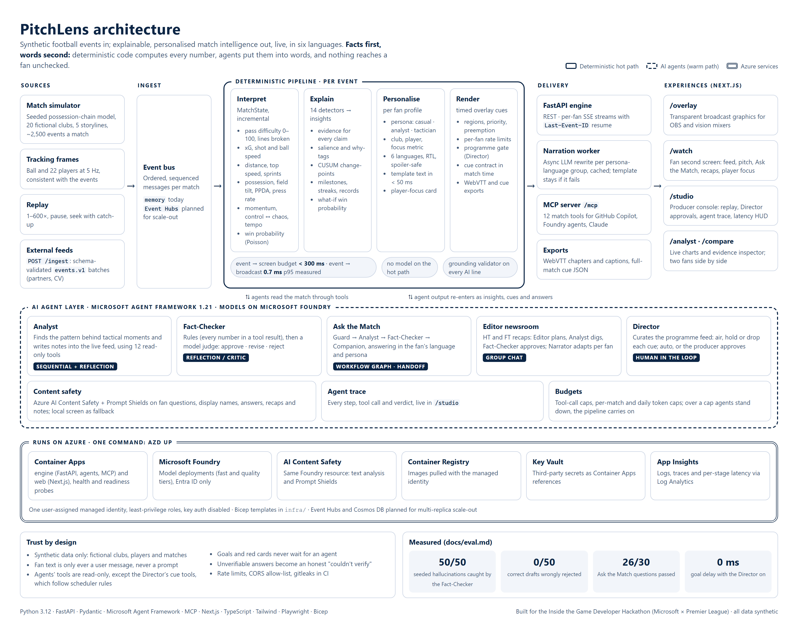

# PitchLens

**Explainable, personalized match intelligence from synthetic football events, built on Azure.**

PitchLens ingests synthetic match events as they happen and turns them into stats, key moments and the reasons those moments matter. It renders the results as timed broadcast overlays, personalized for each fan (persona, language, favorite club or player). A deterministic analytics pipeline computes every number. A team of AI agents (Microsoft Agent Framework on Microsoft Foundry) analyzes, narrates, localizes, fact-checks and directs what goes on screen.

> Built for the **Inside the Game: Developer Hackathon** (Microsoft × Premier League), challenge *Synthetic Match Insights Engine for Premier League Studio*.
> **All data is synthetic.** No real Premier League match data, players or trademarks are used or redistributed.

## Status

🚧 In active development. See [`PROJECT_PLAN.md`](PROJECT_PLAN.md) for the full design, task checklist and timeline.

## Architecture

[](docs/architecture.html)

A **deterministic hot path** turns each event into metrics, explained insights, per-fan text and timed
overlay cues in well under the 300 ms budget, with no model involved. An **AI agent layer** (Microsoft
Agent Framework on Microsoft Foundry) works alongside it: the Analyst, Fact-Checker, Ask the Match,
the Editor's newsroom and the Director, each grounded in the same tools and checked before a fan sees
anything. Everything runs on Azure Container Apps with `azd up`.

The diagram is [`docs/architecture.html`](docs/architecture.html) (open it in a browser for crisp text);
the image is regenerated with `npm run docs:architecture` in `web/`. Details: [agents](docs/agents.md) ·
[insights](docs/insights.md) · [metrics](docs/metrics.md) · [API](docs/api.md) · [evaluation](docs/eval.md) ·
[deployment](docs/deploy.md) · [responsible AI](docs/responsible-ai.md).

## Repository layout

| Path | What |
|---|---|
| `engine/` | Python engine: simulator, metrics, insight detection, agents, API |
| `web/` | Next.js apps: `/overlay`, `/watch`, `/analyst`, `/studio`, `/compare` |
| `data/` | Synthetic rosters and generated matches |
| `docs/` | Schemas, metrics, overlay contract, dataset, agents |
| `infra/` | Bicep + `azd` deployment to Azure |

## Quickstart (local, fully offline)

```bash
# Engine
cd engine
python -m venv .venv && source .venv/Scripts/activate   # Windows Git Bash; use .venv/bin/activate on macOS/Linux
pip install -e ".[dev]"
pytest
python scripts/e2e_smoke.py   # whole system, start to finish (36 checks)

# API (http://localhost:8000/docs) - see docs/api.md
uvicorn pitchlens.api.main:app --reload --port 8000

# Web
cd ../web
npm install
npm run dev            # http://localhost:3000/watch
npm run e2e            # browser end-to-end tests (boots engine + web, drives Chromium)
```

## Run with Docker

```bash
docker compose up --build      # web on http://localhost:3000, engine on http://localhost:8000
```

## Deploy to Azure

```bash
azd auth login
azd env new pitchlens-dev && azd env set AZURE_LOCATION swedencentral
azd up                         # Microsoft Foundry, Container Apps, Content Safety, Key Vault, App Insights
```

See [`docs/deploy.md`](docs/deploy.md) for what gets created, quota, cost and teardown.

## License

[MIT](LICENSE)
